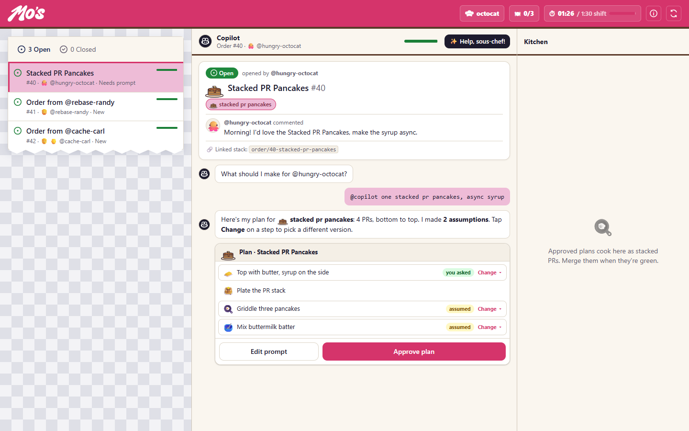
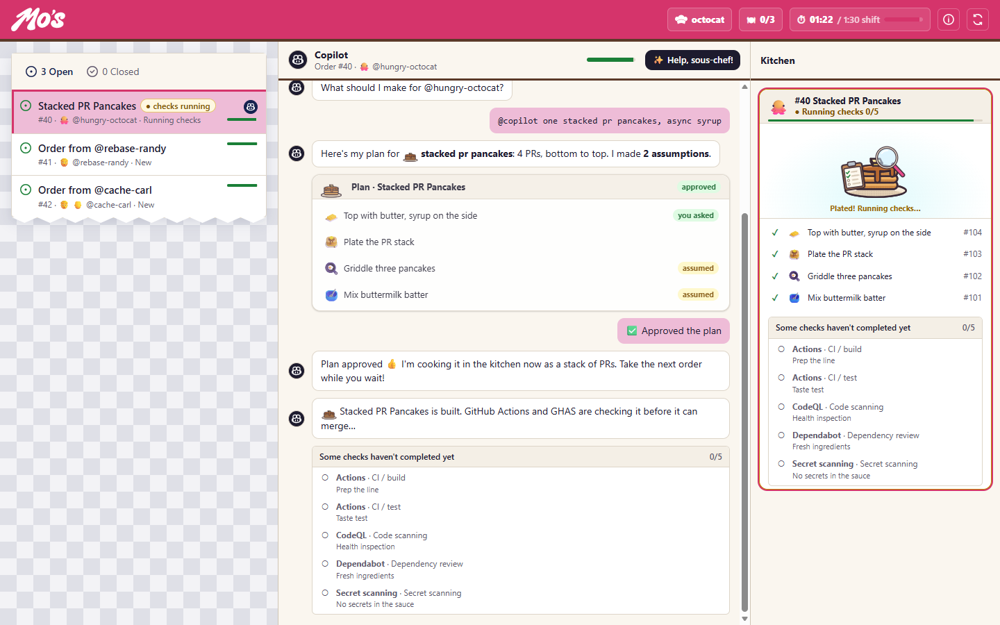

# Hungry Devs. Green checks. Breakfast served.

Pull up a seat at **Mo's Diner**, a GitHub Universe-inspired game in the
**GitHub Copilot app canvas**. You're working the counter; Copilot is your
sous-chef. Turn breakfast orders into prompts, review the plan, and serve a
stack of simulated pull requests.

**On your ticket: three correct orders, 90 seconds, and a kitchen full of checks.**

[Start your shift](#grab-a-booth-in-the-copilot-app) ·
[How to play](#from-order-to-order-up) ·
[Mo's Diner recipes on GitHub Docs](https://docs.github.com/en/mos-diner)


## Grab a booth in the Copilot app

Mo's Diner is a **project canvas extension for the GitHub Copilot app**.
Use the app to install and play, not a browser tab, VS Code extension, or
standalone CLI session.

1. In the **GitHub Copilot app**, add
   [`crazy4pi314/mos-diner-game`](https://github.com/crazy4pi314/mos-diner-game)
   as a repository and open a session in it.
2. Ask Copilot:

   ```text
   Load this repository's Mo's Diner canvas extension and open the Mo's Diner canvas.
   ```

3. Enter your chef name in the canvas and select **Start your shift!**

You'll need an app build with project canvas-extension support. There is no
package installation or build step for the game. Once open, gameplay interprets
prompts locally: **no model calls, Copilot usage, or real pull requests**.
The app's own account and access requirements still apply.

See [installation and troubleshooting](docs/INSTALL.md) if the canvas doesn't
appear.

## From order to order up

1. **Take the order.** Read the customer's request; the details matter.
2. **Prompt your sous-chef.** Choose a dish and detail chips, or type a request
   such as `@copilot one stacked pr pancakes, async syrup`.
3. **Review the plan.** Compare *you asked* and *assumed* details with the order.
   Edit any wrong steps, then select **Approve plan**.
4. **Merge & serve.** Let the kitchen cook the PR stack while you take another
   order. When checks are green, select **Merge & serve**.

A wrong order comes back with the mismatched step highlighted. Fix the plan
and try again. Finish the shift to add your time to a tear-off kitchen ticket
showing this session's three fastest shifts. Play again to beat your best.
Closing or refreshing the canvas clears the board; there are no redeemable prizes.



*Read the ticket. Check the assumptions. Approve only what you mean to serve.*



*An approved plan becomes a PR stack. Green checks are your cue to merge and serve.*

Screenshots show the game canvas content; the surrounding Copilot app chrome
is omitted.

## Make yourself comfortable

The canvas uses **Orders / Prep / Kitchen** navigation, with tabs on
smaller canvases.

Help pauses the shift. Hidden pages and canvases pause too; select
**Resume shift** when you return. **Reset game** starts over, and reopening
the game starts a fresh shift.

## Keep the recipes

Take the lessons beyond the counter. The
[Mo's Diner collection on GitHub Docs](https://docs.github.com/en/mos-diner)
has recipes for implementing a feature from an issue, stacking AI-generated
pull requests, and customizing Copilot code review.


## Join the kitchen

See [Contributing](CONTRIBUTING.md) for setup, focused checks, and pull request
guidance, or [the developer reference](docs/DEVELOPMENT.md) for architecture,
menu customization, and canvas behavior. Coding agents should start with
[AGENTS.md](AGENTS.md).

Use the [issue templates](https://github.com/crazy4pi314/mos-diner-game/issues/new/choose)
for bugs and ideas. Please follow our [Code of Conduct](CODE_OF_CONDUCT.md).
Report vulnerabilities privately using the [security policy](SECURITY.md),
not a public issue.

## License and house credits

Project code is distributed under the [MIT license](LICENSE).
Bundled fonts retain their SIL Open Font License notices. GitHub and Copilot
names, logos, and other branding are not relicensed by the code license; see
[third-party notices](THIRD_PARTY_NOTICES.md) before reusing assets.
