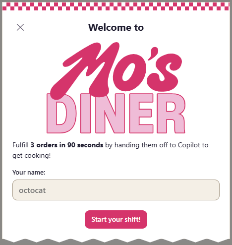

# Grab a booth: installation

## Your table is in the GitHub Copilot app

Mo's Diner is a **canvas extension for the GitHub Copilot app**. The public
installation path is through that app, not a standalone web page, VS Code
extension, or terminal-only Copilot CLI.

You need the GitHub Copilot app with **project canvas-extension support** and
access to this repository. Follow the app's sign-in and account requirements.
The game itself has no package installation, build, or API-key setup.

## Open for breakfast

1. Open the **GitHub Copilot app**.
2. Add [`crazy4pi314/mos-diner-game`](https://github.com/crazy4pi314/mos-diner-game)
   as a repository in the app, then open a session in that repository.
3. Send this prompt:

   ```text
   Load this repository's Mo's Diner canvas extension and open the Mo's Diner canvas.
   ```

4. Copilot loads `.github/extensions/mos-diner/` and opens the game beside
   your conversation.
5. Enter your chef name and select **Start your shift!**



The app resolves the extension SDK. Do not install a separate SDK or run an npm
command to play. Merely having a Copilot subscription or an editor extension
does not provide this canvas feature.

## What stays local

The canvas runs a local server bound to `127.0.0.1`. It does not expose a public
game server or use a model for gameplay. Playing does not consume Copilot usage
or create real pull requests; the app's agent conversation is separate.
Canvas checkpoints are stored under
`~/.copilot/mos-diner/mos-diner-game/`, outside the public asset tree. They
coordinate active control, not saved-game restoration: reopening starts a
fresh shift. See the [developer reference](DEVELOPMENT.md#pausing-and-resetting)
for controller leases and recovery.

## If the grill won't start

| Symptom | What to check |
| --- | --- |
| Canvas not available | Confirm your GitHub Copilot app build supports project canvas extensions and the session is in this repository. Ask Copilot to reload and inspect the extension. |
| Extension load fails | Ask Copilot to inspect the `mos-diner` extension log and report the error. The extension requires the app-provided SDK. |
| Missing styles, fonts, or images | Confirm the app has the full repository, including `assets/`, then reopen the canvas. |
| Start is disabled or loading fails | Read the information dialog and use **Retry loading** after addressing the reported problem. |
| Game pauses after switching away | Return to the game and explicitly select **Resume shift**. |
| Saving diner control timed out | Select **Resume shift** to verify the checkpoint and continue the live shift. If another view changed it, close and reopen for a fresh shift. |
| Another view controls the game | Close the other panel or use a distinct `gameId`; do not delete active state or locks. |

For an unresolved problem, use the
[bug report template](https://github.com/crazy4pi314/mos-diner-game/issues/new/choose).
Remove personal paths, tokens, and private session data from logs and screenshots.

For extension troubleshooting, Copilot can use `extensions_reload` and then
`extensions_manage` with `operation: "inspect", name: "mos-diner"`. Reloading
restarts all loaded extensions, not just this game.

Development and test setup is documented separately in
[Contributing](../CONTRIBUTING.md).
